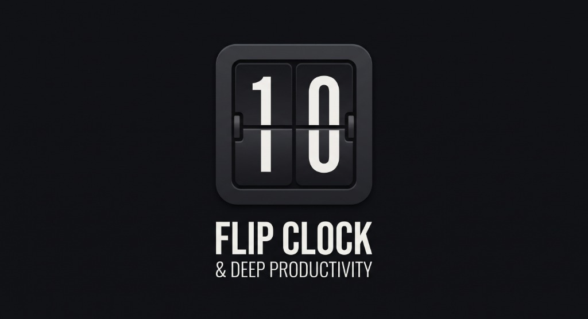
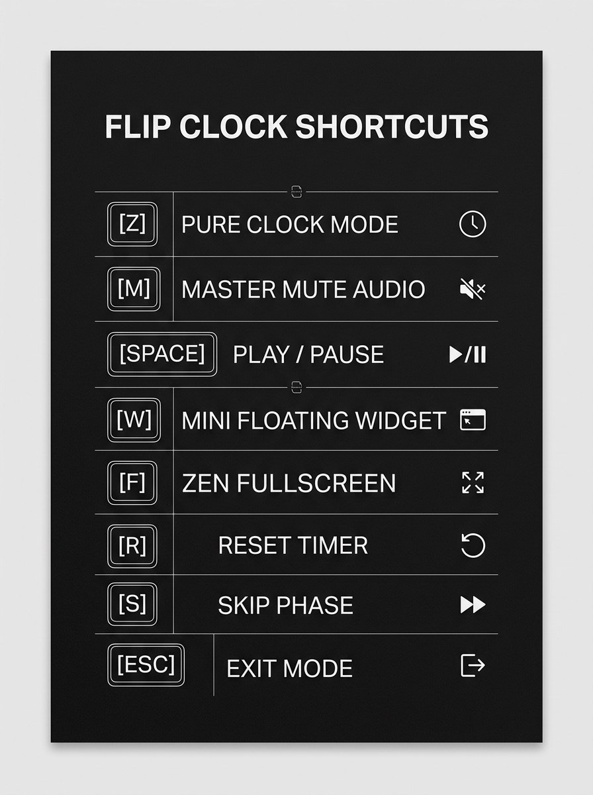

# Minimalist Monochrome Flip Clock & Deep Productivity Desktop App

<p align="center">
  
</p>

An architectural desktop timepiece and deep productivity workstation built with **Electron**, **Vite**, and **Modern Web Audio**. Designed for developers, designers, and deep workers seeking an uncompromising, distraction-free environment.

---

## Demo

https://github.com/user-attachments/assets/YOUR-VIDEO-ID
---

## Download

Get the latest Windows installer from the [**Releases page**](https://github.com/mohamedfo17/flip-clock/releases/latest).

> **Windows SmartScreen:** the installer is not code-signed, so Windows may show "Windows protected your PC". Click **More info**, then **Run anyway**.

---

## Value Proposition

Transform your workstation into an intentional focus sanctum. Blending the tactile nostalgia of Solari split-flap mechanical clocks with modern deep-work productivity (Pomodoro, ambient audio synthesis, and GitHub-style focus heatmaps), this app replaces digital clutter with monumental typographic clarity.

---

## Top 3 Key Features

1. **Architectural 3D Split-Flap Clock Engine & Pure Mode**
   - Monumental, tactile split-flap cards with realistic card seam grooves, top/bottom half lighting contrast, and independent mini AM/PM split card.
   - **Pure Clock Mode (<kbd>Z</kbd> / Double-Click)**: Instantly eliminates all UI chrome, leaving only the floating flip clock and time with balanced margins.

2. **Deep Productivity Analytics Suite**
   - 28-day GitHub-style focus heatmap tracking daily intensity with interactive tooltips.
   - Focus by Time of Day (Morning, Afternoon, Evening, Night Owl) and task distribution breakdown.
   - Chronological session logs with one-click CSV and JSON data export.

3. **Offline Web Audio Focus Soundscape & Master Mute**
   - Zero-external-dependency procedural audio synthesis for Rain, Ocean Waves, Campfire, Brown Noise, and White Noise.
   - Authentic mechanical split-flap clack and Tibetan singing bowl transition chimes.
   - **Master Mute (<kbd>M</kbd>)**: Instant global silence button and hotkey.

---

## Keyboard Shortcuts

<p align="center">
  
</p>

<details>
<summary>Text version</summary>

| Shortcut | Function |
| :--- | :--- |
| <kbd>Z</kbd> / Double-Click | **Pure Clock Mode** (Zero controls, only clock & time) |
| <kbd>M</kbd> | **Master Mute All Audio** (Instant silence) |
| <kbd>Space</kbd> | Start / Pause Active Timer |
| <kbd>R</kbd> | Reset Active Timer |
| <kbd>S</kbd> | Skip Pomodoro Phase |
| <kbd>W</kbd> | Toggle **Floating Mini Widget** Mode |
| <kbd>F11</kbd> / <kbd>F</kbd> | Toggle **Zen Fullscreen** Mode |
| <kbd>ESC</kbd> | Exit Pure Clock Mode / Dismiss Drawers |

</details>

---

## Quickstart

```powershell
# Install dependencies
npm install

# Build production bundle
npm run build

# Launch desktop app
npm start
```

### Build the installer

```powershell
npm run dist
```

The installer is written to the `release/` folder (for example `Flip Clock Setup 1.0.0.exe`).

---

## Tech Stack

- **Electron** (main process, preload bridge, tray and window management)
- **Vite** (renderer build)
- **Web Audio API** (procedural soundscapes and mechanical sound effects)
- **electron-builder** (packaging and installers)

---

## License

Released under the [MIT License](LICENSE).
